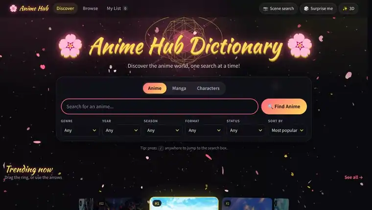
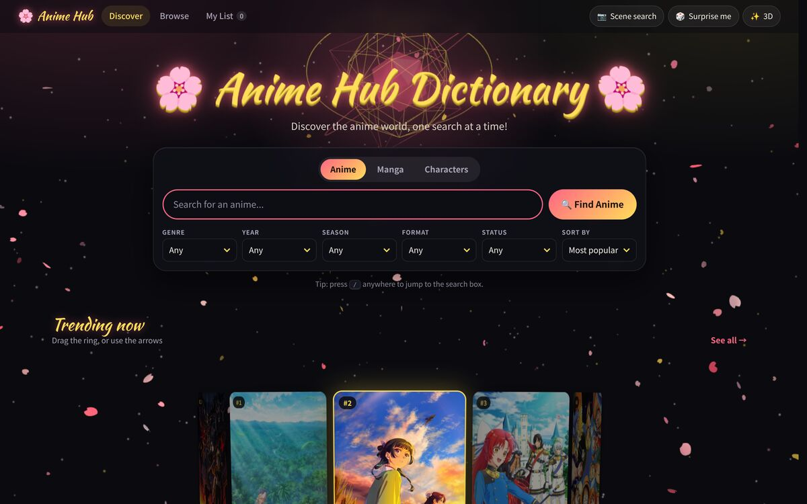
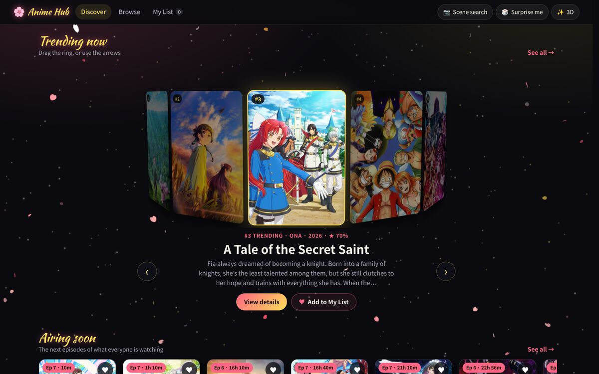
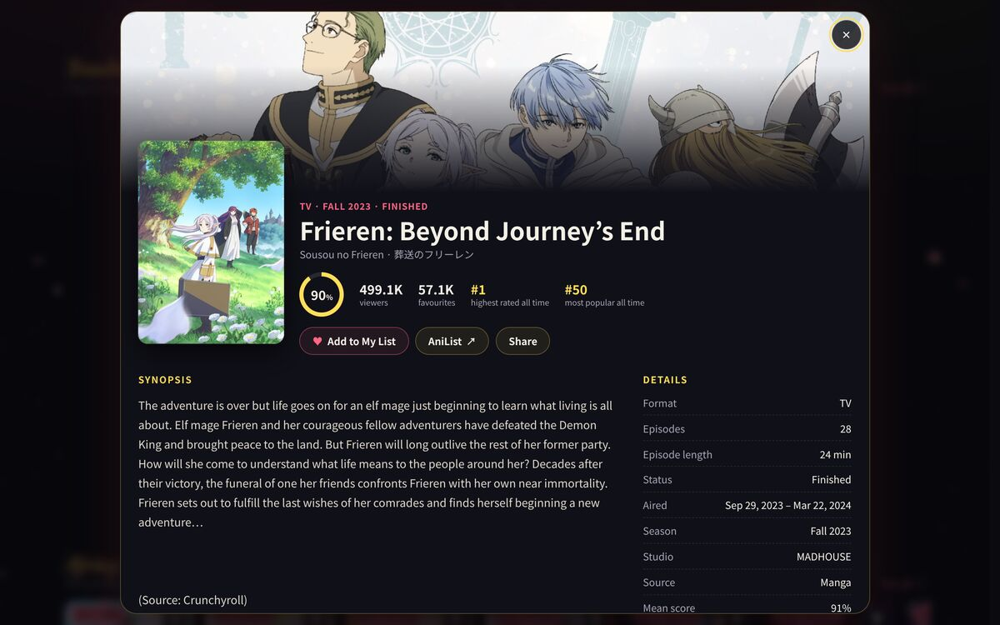

<p align="center">
  
</p>

<p align="center">
  <a href="https://theanomality.github.io/AnimeWiki/"><b>🌸 Open the live site</b></a>
  &nbsp;·&nbsp;
  <a href="#features">Features</a>
  &nbsp;·&nbsp;
  <a href="#3d-and-animation">3D</a>
  &nbsp;·&nbsp;
  <a href="#self-contained-by-design">Self-contained</a>
  &nbsp;·&nbsp;
  <a href="#run-it-locally">Run it</a>
</p>

<p align="center">
  Search anime, manga and characters. See what is trending and airing.<br>
  Find where to watch, or identify an anime from a single screenshot.
</p>

<p align="center">
  
</p>


## Features

<table>
  <tr>
    <td width="33%" valign="top">
      <h3>🔍 Search everything</h3>
      Anime, manga and characters behind one switch. Results update as you type.
    </td>
    <td width="33%" valign="top">
      <h3>🎛️ Filter and sort</h3>
      Genre, year, season, format and status. Sort by popularity, score, trending, newest and more.
    </td>
    <td width="33%" valign="top">
      <h3>🔥 Discover</h3>
      Trending now, airing soon with live countdowns, this season, next season, top rated and trending manga.
    </td>
  </tr>
  <tr>
    <td valign="top">
      <h3>📖 Rich detail pages</h3>
      Synopsis, score, rankings, trailer, where to watch, cast and voice actors, staff, related titles and recommendations.
    </td>
    <td valign="top">
      <h3>🧑‍🎤 Character pages</h3>
      Biography with click-to-reveal spoilers, birthday, and every title they appear in.
    </td>
    <td valign="top">
      <h3>📷 Scene search</h3>
      Drop in a screenshot to get the anime, the episode and the exact timestamp.
    </td>
  </tr>
  <tr>
    <td valign="top">
      <h3>💛 My List</h3>
      Save favourites in your browser. Back them up to a file and restore them anywhere.
    </td>
    <td valign="top">
      <h3>🔗 Shareable links</h3>
      Every search, filter and detail page has its own URL. Back and Forward just work.
    </td>
    <td valign="top">
      <h3>📱 Works everywhere</h3>
      Phone to widescreen, mouse, touch or keyboard, and friendly to screen readers.
    </td>
  </tr>
</table>

Plus **🎲 Surprise me**, which opens a random popular anime.

## Screenshots

<table>
  <tr>
    <td width="33%"></td>
    <td width="33%"></td>
    <td width="33%"></td>
  </tr>
  <tr>
    <td align="center"><sub>Search over a live 3D scene</sub></td>
    <td align="center"><sub>The trending ring</sub></td>
    <td align="center"><sub>A details page</sub></td>
  </tr>
</table>


## 3D and animation

| | |
| --- | --- |
| **WebGL background** | Sakura petals falling through 3D space, a star field and a rotating neon gem behind the title. It follows your pointer, drifts as you scroll and speeds up while data loads. |
| **Trending ring** | A true CSS 3D carousel. Drag it, swipe it, or step through with the arrows. |
| **Tilting cards** | Cards lean toward the pointer with a moving highlight and layered depth. |
| **3D entrances** | Cards flip up into place, dialogs swing in, and the title is extruded 3D lettering. |

The **✨ 3D** button turns all of it off and back on. If your system asks for reduced motion, effects start switched off and three.js is never loaded. On slow devices the scene sheds detail on its own.

## Self-contained by design

The whole app is static files. Nothing to install, nothing to host besides the files themselves.

| | |
| --- | --- |
| **No database** | Favourites and settings live in your browser's `localStorage`. API responses are cached in `sessionStorage`. |
| **No server** | It runs on GitHub Pages, any static host, or straight from your disk. |
| **No build step** | Plain HTML, CSS and JavaScript. No framework, no bundler, no `npm install`. |
| **No API key** | Every API it uses is public and keyless. |
| **No CDN required** | three.js and both fonts are bundled in the repository. |

**Your data is a file.** On the My List page, **Back up** downloads your list as `anime-hub-my-list.json` and **Restore** loads it into any browser. That file is the entire "database".

> Opened straight from disk (`file://`), browsers refuse to load JavaScript modules from local files, so the 3D background alone fetches the same three.js version from jsDelivr. Everything else is local. Served over http(s), the only outside requests are to the anime data sources above, plus YouTube when a title has a trailer.

## Public APIs

| API | Used for |
| --- | --- |
| [AniList GraphQL](https://docs.anilist.co) | All anime, manga and character data |
| [Jikan](https://jikan.moe) (MyAnimeList) | MyAnimeList score and opening/ending songs on detail pages |
| [trace.moe](https://soruly.github.io/trace.moe-api/) | Scene search from a screenshot |

How the AniList API is put to work:

- **One request for the whole Discover page.** Six lists and the genre collection arrive together through GraphQL aliases.
- **Polite to the rate limit.** Responses are cached, identical in-flight requests are shared, and a client-side budget keeps the app under the per-minute limit. On a `429` it waits as long as the server asks, tells you, and retries by itself.
- **Errors handled properly.** AniList can return errors with HTTP 200, so the `errors` array is always checked. Network failures, timeouts, "not found" and outages each get their own message and a retry button.
- **Pagination by `hasNextPage` only**, as the AniList docs recommend.
- **All-ages only.** Every query sends `isAdult: false`.

Jikan and trace.moe are optional extras. If either is unreachable, the rest of the site carries on normally.


## Run it locally

```bash
git clone https://github.com/TheAnomality/AnimeWiki.git
cd AnimeWiki
```

Open `index.html` in your browser. That is all.

Prefer a local server? Any static one works:

```bash
python3 -m http.server 8000
# then open http://localhost:8000
```

## Keyboard

| Key | Action |
| --- | --- |
| <kbd>/</kbd> | Jump to the search box |
| <kbd>Enter</kbd> | Search |
| <kbd>←</kbd> <kbd>→</kbd> | Turn the trending ring when it has focus |
| <kbd>Esc</kbd> | Close a dialog |

## Project layout

```
AnimeWiki/
├── index.html        page structure, dialogs, Content Security Policy
├── style.css         theme, layout, CSS 3D ring, card tilt, responsive rules
├── script.js         the app: routing, search, filters, rendering, My List, scene search
├── api.js            AniList, Jikan and trace.moe clients: caching, rate limiting, errors
├── scene.js          the WebGL background
├── utils.js          HTML escaping and sanitizing, formatting, small helpers
├── lib/              three.js (bundled)
└── assets/           fonts (bundled) and the images used in this README
```

## Privacy and safety

- Favourites and settings never leave your browser.
- Scene search sends the image you pick to trace.moe so it can be matched. It is shrunk in your browser first. Nothing else is uploaded anywhere.
- Everything that comes from an API is escaped before it reaches the page, descriptions pass through a whitelist sanitizer, and a Content Security Policy limits what the page may load.

## Contributing

Contributions are welcome! Fork the repository and open a pull request with your improvement or new feature.

## Credits

- Data: [AniList](https://anilist.co), [MyAnimeList](https://myanimelist.net) through [Jikan](https://jikan.moe), and [trace.moe](https://trace.moe)
- 3D: [three.js](https://threejs.org) (MIT, see `lib/LICENSE-three.txt`)
- Fonts: Kaushan Script and Noto Sans JP (SIL Open Font License, see `assets/fonts/`)

This is a fan project and is not affiliated with AniList, MyAnimeList or trace.moe.

<p align="center">
  <br>
  Made with ❤️ and a dash of otaku magic.
</p>
